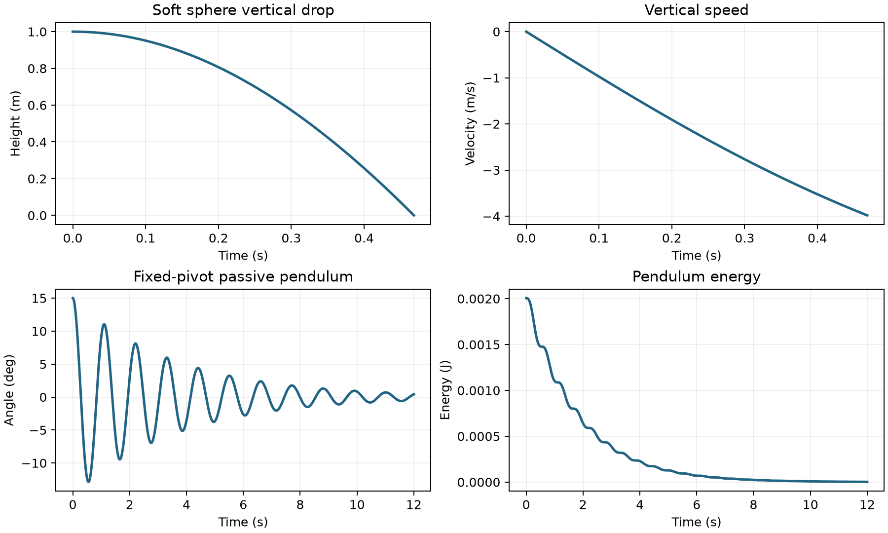

# DART

仓库包含被动运动教学实验，以及 ROS 2 Humble/C++ OpenCV 圆形绿光验证链路。
ROS 2 工作区按 `camera_node`、`detect_node`、`mcu_node`、`estimate_node` 划分；
只发布测量和估计结果，不连接执行机构，也不发布 MCU 控制指令。

## 圆形绿光视觉验证

代码位于 `ros2_ws/`：

- `dart_interfaces`：结构化 `GreenLight` 消息；
- `camera_node`：Daheng 相机采集（SN `KE0210080605`）；
- `detect_node`：C++ OpenCV 圆形绿光检测；
- `mcu_node`：经串口接收 MCU 的原始 IMU 数据；
- `estimate_node`：将当前绿灯测量与时间最近的 IMU 样本配对；
- `dart_bringup`：统一启动四节点；
- `tools`：无相机时使用的合成移动绿圆发布器和正检探针。

节点默认对接：

- 相机 SN：`KE0210080605`；
- 图像：`/camera_node/image_raw`；
- 标定：`/camera_node/camera_info`；
- 检测输出：`/detect_node/detection`；
- 调试图：`/detect_node/debug_image`；
- MCU RX：`/mcu_node/message/rx`；
- 估计输出：`/estimate_node/target`。

构建并启动完整链路：

```bash
cd ros2_ws
source /opt/ros/humble/setup.bash
colcon build --symlink-install
source install/setup.bash
ros2 launch dart_bringup dart.launch.py
```

验证结果见 [`docs/绿灯识别验证记录.md`](docs/绿灯识别验证记录.md)，节点迁移范围见
[`docs/ROS2节点迁移说明.md`](docs/ROS2节点迁移说明.md)。`ros_sp` 保持只读、未被修改。

## 原有被动运动教学实验

这一部分限于柔性球体竖直下落、固定支点阻尼摆和桌面视觉学习，不包含主动尾翼控制。

## 查看报告

- `reports/教学仿真与硬件选型.md`：安装核查、13组官方资料、OpenMV 与树莓派分析。
- `reports/教学仿真与硬件选型.docx`：同内容 Word 文档，采用现代 DOCX 格式。

## Windows MATLAB 运行

找到的 MATLAB 为 Windows R2025b；当前 Linux 环境没有执行 MATLAB。先将整个项目复制到 Windows 可写目录，在 MATLAB 切换到项目根目录，执行：

```matlab
addpath('simulation')
audit_matlab
run_passive_demo
```

输出在 `results/matlab`。基础仿真只需要 MATLAB；工具箱核查脚本单独运行。当前未交付 SLX 模型。

## 当前 Linux 环境复现

本次已在项目私有 `.local-python` 目录安装计算依赖，没有修改 MATLAB 安装目录。

```bash
PYTHONPATH="$PWD/.local-python" /home/keylinkatasga/.cache/codex-runtimes/codex-primary-runtime/dependencies/python/bin/python3 simulation/run_passive_demo.py
```

其他电脑可在独立 Python 环境安装 `simulation/requirements.txt`，然后执行 `python simulation/run_passive_demo.py`。

## 实际验证结果

Python 版本已执行，所有数值断言通过。MATLAB 版本尚未运行，不能把 Python 结果视为 MATLAB 运行结果。

| 检查项 | 结果 |
| --- | --- |
| 常阻力下落至地面的时间 | 0.4683679598 s |
| 与解析高度解最大误差 | 1.23 × 10⁻¹² m 以下 |
| 无阻力下落时间误差 | 3.34 × 10⁻¹⁶ s 以下 |
| 最大步长减半后时间变化 | 3.00 × 10⁻¹³ s 以下 |
| 下落模型机械能不增长 | 通过 |
| 阻尼摆机械能不增长 | 通过 |

这些是简化方程的数值一致性检查，不是实物精度声明；并未进行空气动力标定。



## 模型定义

下落模型：`dz/dt = v`，`dv/dt = -g - c*abs(v)*v`，其中 `c = rho*Cd*pi*r^2/(2*m)`。初始高度 1 m，初始速度为零，高度向上为正，零高度向下穿越事件终止积分。

固定支点摆：`dtheta/dt = omega`，`domega/dt = -(g/L)*sin(theta) - (b/J)*omega`，`J = m*L^2`。不含驱动和反馈。实验参数及假设见报告。
